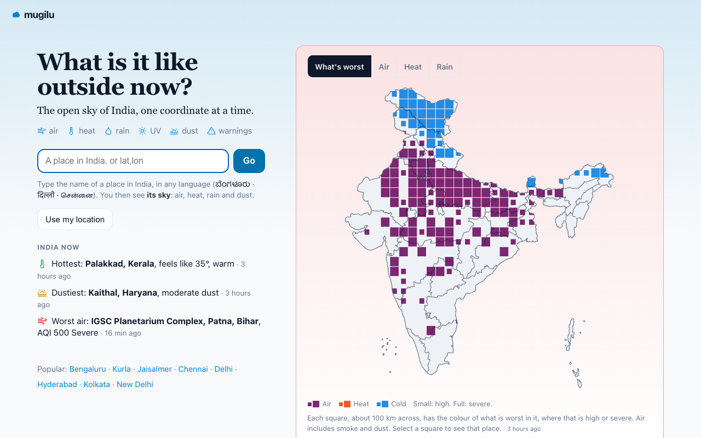
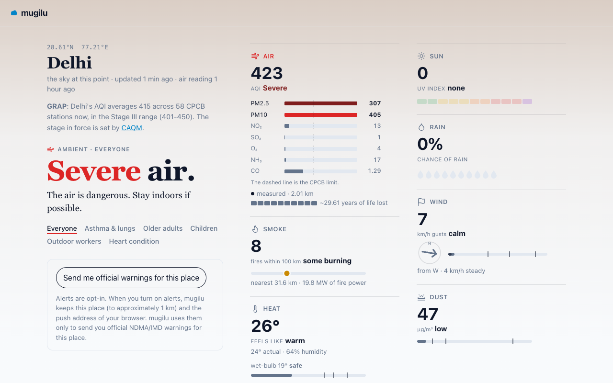
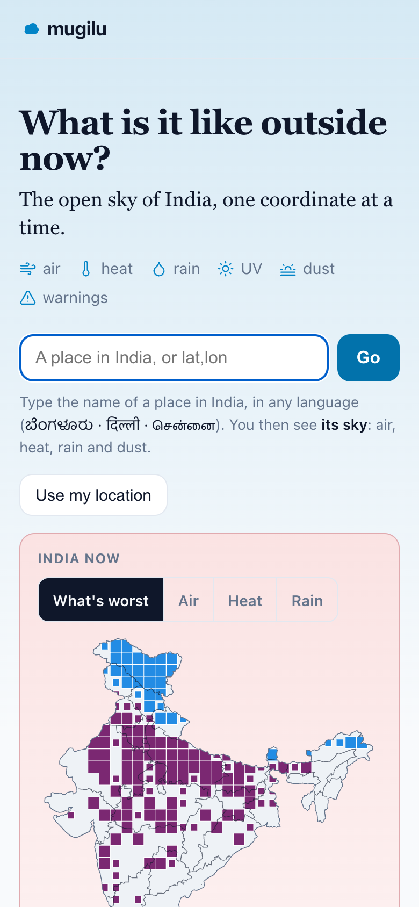

# mugilu

**The open sky of India, one coordinate at a time.** Air quality, heat, rain, fog, smoke, UV and official warnings for any place in India, as a web page, an API and an MCP server for AI assistants.

[](./LICENSE)
[](https://mugilu.live)
[](https://github.com/urbanmorph/mugilu/actions/workflows/ci.yml)
[](https://registry.modelcontextprotocol.io/v0/servers?search=io.github.sathya-sankaran/mugilu)
[](https://workers.cloudflare.com)
[](https://glama.ai/mcp/connectors/io.github.sathya-sankaran/mugilu)



ಮುಗಿಲು (*mugilu*) is Kannada for *cloud* or *sky*. It is the third tool in a small commons, alongside [bharatlas](https://bharatlas.com) (open geo data for India) and [mdshare](https://mdshare.live). Live at [mugilu.live](https://mugilu.live).

> [!IMPORTANT]
> mugilu is informational and educational only. It is **not for medical, emergency or safety-critical decisions**, and there is no warranty or accuracy guarantee. For official hazard warnings, NDMA and IMD are the authoritative channels.

## Contents

- [What it does](#what-it-does)
- [Features](#features)
- [Screenshots](#screenshots)
- [Use it on the web or as an API](#use-it-on-the-web-or-as-an-api)
- [Use it from an AI assistant (MCP)](#use-it-from-an-ai-assistant-mcp)
- [Data sources and attribution](#data-sources-and-attribution)
- [How it works](#how-it-works)
- [Project layout](#project-layout)
- [Development](#development)
- [Deploy](#deploy)
- [Contributing](#contributing)
- [Principles](#principles)
- [Licence](#licence)

## What it does

Give mugilu a place in India (a name in any script, or a `lat,lon`) and it tells you what the sky is doing to you right now. Air apps show air, weather apps show weather, and the government's own data sits in separate apps that do not talk to each other. mugilu puts these into one location-addressable layer for India.

Readings are current, not a forecast. They recompute on a cycle of about 15 minutes.

## Features

- **Conditions at any point.** Air quality from real ground stations (modelled where no station is within 50 km, and labelled so), heat with feels-like and wet-bulb, today's high against the 1991-2020 normal, cold, rain, UV, dust, wind, fog and visibility, fire and crop-burn smoke, and active official warnings.
- **Readings against their limits.** Each reading is drawn against the limits it is judged by (for example the CPCB limit for each pollutant), in the order that matters to you now.
- **Ambient read.** One line that names the single worst hazard for you and what to do about it.
- **Weighted for who is asking.** Pass a persona (asthma, older adults, children, outdoor workers, heart condition) and the Ambient read is weighted for that group.
- **Health impact.** Years of life lost from the air, using the AQLI methodology.
- **India now.** A national map and leaderboard of the worst-air, hottest and dustiest places.
- **Many formats.** HTML for people, JSON for apps, Markdown for LLMs, a timestamped PNG, an embeddable card, a self-refreshing display for a wall screen, and an MCP server for agents.
- **Three languages.** English, Hindi and Kannada pages; place search accepts native scripts (ಬೆಂಗಳೂರು, दिल्ली, சென்னை).
- **Installable web app.** It keeps the last reading of places you opened for offline use, refreshes itself when it comes back on screen, and can send opt-in alerts for official warnings at a place.
- **Plain HTML.** Every page reads without JavaScript.

## Screenshots

| A city page ([/c/delhi](https://mugilu.live/c/delhi)) | Homepage on a phone |
| --- | --- |
|  |  |

## Use it on the web or as an API

Open and keyless.

- [mugilu.live](https://mugilu.live): type any place, in any language.
- A point: [/c/12.97,77.59](https://mugilu.live/c/12.97,77.59). A place: [/c/bengaluru](https://mugilu.live/c/bengaluru). For someone: [/c/delhi?as=asthma](https://mugilu.live/c/delhi?as=asthma).

```bash
# JSON, by coordinate or by name, optionally weighted for a vulnerability
curl https://mugilu.live/c/12.97,77.59.json
curl "https://mugilu.live/c/delhi.json?as=asthma"
```

A trimmed response (the full layers are `air`, `heat`, `heat_vs_normal`, `rain`, `uv`, `dust`, `wind`, `visibility`, `smoke`, `warnings` and `nearby_warnings`; `ambient.order` lists the readings in the order every surface shows them):

```json
{
  "schema": "mugilu/conditions",
  "version": 1,
  "place": "Delhi, Delhi",
  "ambient": {
    "risk_band": "severe",
    "driver": "heat",
    "persona": "asthma",
    "summary": "The heat is dangerous. Go to a cool place out of the sun. Drink water.",
    "order": ["heat", "air", "sun", "rain", "dust"]
  },
  "air": { "kind": "measured", "aqi": 140, "band": "moderate", "yll_years": 0.83 },
  "heat": { "apparent_c": 46, "wet_bulb_c": 27 },
  "attribution": "… via mugilu",
  "disclaimer": "Informational only, not for medical, emergency, or safety-critical decisions. For official hazard warnings consult NDMA / IMD."
}
```

### Routes

| Route | Returns |
| --- | --- |
| `/c/{lat},{lon}` (+ `.json` `.md` `.png`) | Conditions at a point: HTML, JSON, Markdown, or a timestamped image |
| `/c/{slug}` | A named place, for example `/c/bengaluru` |
| `?as=` (`asthma`, `elderly`, `child`, `outdoor`, `heart`) | Weight the Ambient read for a vulnerability |
| `/hi/…`, `/kn/…` | The same pages in Hindi or Kannada |
| `/display`, `/c/{place}?kiosk` | Set up a wall screen; the self-refreshing display |
| `/warnings`, `/places` | Active warnings across India; every district and city |
| `/near`, `/suggest` | Nearest air stations; place search (native scripts work) |
| `/index.json`, `/warnings.json` | National air leaderboard; active NDMA/IMD warnings |
| `/embed/{lat},{lon}` | Embeddable card, one line of HTML |
| `/mcp`, `/openapi.json`, `/llms.txt` | MCP server; OpenAPI 3.1 spec; LLM manifest |
| `/methodology`, `/terms` | Every threshold used; terms and per-source credits |
| `?ref=your-app` | Self-identify on any API or embed call (aggregate attribution) |

### Refresh rate

Air and official warnings change hourly; weather at most every 15 minutes. Each conditions response carries every metric with its own `as_of`, and a `refresh_after_seconds` field mirrored by the `Cache-Control` max-age on the JSON, Markdown and `/embed` surfaces. Poll at most once every 15 minutes per place; faster returns identical data. If you embed the card, refresh the iframe every 15 minutes or so, or use `/c/{place}?kiosk`, which refreshes itself.

## Use it from an AI assistant (MCP)

mugilu runs a remote MCP server (JSON-RPC 2.0 over Streamable HTTP, protocol version 2025-06-18). No key or install is needed.

```text
https://mugilu.live/mcp
```

It is published in the official [MCP Registry](https://registry.modelcontextprotocol.io/v0/servers?search=io.github.sathya-sankaran/mugilu) as `io.github.sathya-sankaran/mugilu` (version 1.0.1; the entry is in [`server.json`](./server.json)) and is listed on Glama.

- **Claude or Cursor:** add `https://mugilu.live/mcp` as a custom connector, then ask, for example, *"is it safe for my asthmatic kid to play outside in Indiranagar right now?"*
- **Claude Code:** `claude mcp add --transport http mugilu https://mugilu.live/mcp`
- **MCP Inspector:** list the tools from the command line:

  ```bash
  npx @modelcontextprotocol/inspector --cli https://mugilu.live/mcp --transport http --method tools/list
  ```

### Tools

All tools are read-only and cover India only.

| Tool | What it does | Inputs |
| --- | --- | --- |
| `conditions_at` | What the sky is doing at a place right now (not a forecast): air quality (CPCB AQI, pollutants, AQLI years of life lost), heat (feels-like, wet-bulb, WBGT), cold, rain, wind, fog and visibility, dust, fire smoke, UV, and any official NDMA warning over that spot, plus an Ambient read naming the single worst hazard and the readings in order of risk (`ambient.order`). Where it stands out, today's modelled daily high against the 1991-2020 normal. | `place` (name or `"lat,lon"`, required); `persona` (`everyone`, `asthma`, `elderly`, `child`, `outdoor`, `heart`) |
| `search_place` | Resolves an Indian place name to candidates (name, detail, coordinate). Covers cities, districts and air-monitoring stations. Use it to disambiguate before `conditions_at`. | `query` (required) |
| `nearest_stations` | The nearest real (measured) air-quality stations to a place, with distance and current AQI. Shows how close hard measurement is. | `place` (required); `n` (1 to 20, default 5) |
| `active_warnings` | Official NDMA/IMD hazard warnings active across India, optionally filtered by a region or state name (matched against the headline). | `region` (optional) |
| `national_now` | The national picture right now: the worst-air, hottest and dustiest spots in India. | `kind` (`all`, `air`, `heat`, `dust`; default `all`) |

Every response carries `attribution` and `disclaimer` fields; please show them to the user.

mugilu does not resolve sub-city wards, hospitals, forests, rivers, highways or administrative boundaries. For those, pair it with the [bharatlas](https://bharatlas.com) MCP: let bharatlas find the feature and its coordinate, then pass the coordinate to `conditions_at`.

## Data sources and attribution

mugilu's code is MIT. The data is **not** relicensed: each source keeps its own licence and terms. Credits ride with every response; see the per-page attribution and [/terms](https://mugilu.live/terms). This table follows [`apps/worker/src/sources.ts`](./apps/worker/src/sources.ts), the single source of truth.

| Layer | Source |
| --- | --- |
| Air (measured) | CPCB (Central Pollution Control Board, Govt. of India), Airnet ([CSTEP](https://cstep.in)), Aurassure and Google AirView+, via the OAQ broker ([oaq.notf.in](https://oaq.notf.in)) |
| Modelled air (no station within 50 km), heat, rain, UV, dust, wind | [Open-Meteo](https://open-meteo.com) (CC-BY 4.0) |
| Heat compared with normal | 1991-2020 normals of ERA5 reanalysis (Copernicus Climate Change Service) via Open-Meteo |
| Official warnings | NDMA / IMD (SACHET) |
| Fire and crop-burn smoke | NASA FIRMS (VIIRS) |
| Cyclone tracks | JTWC (US Navy and Air Force; public domain) |
| Geography and place names | Place search from OpenStreetMap contributors (ODbL) and GeoNames (CC-BY 4.0, via the Open-Meteo geocoder); admin boundaries from [bharatlas](https://bharatlas.com) |
| Health impact (years of life lost) | The [AQLI](https://aqli.epic.uchicago.edu/) methodology (U Chicago EPIC) |

The heat normals are built offline on a 1° grid by [`apps/worker/scripts/build-heat-normals.ts`](./apps/worker/scripts/build-heat-normals.ts) and shipped in `apps/worker/data/heat-normals.json`; coverage is still being completed. The full methodology, with every threshold, is at [/methodology](https://mugilu.live/methodology).

## How it works

mugilu is a single Cloudflare Worker ([`apps/worker`](./apps/worker)).

- **Crons** ([`wrangler.toml`](./apps/worker/wrangler.toml)): hourly jobs refresh the air snapshot, NASA FIRMS fires and NDMA/SACHET warnings into R2 and send opt-in warning alerts; every four hours a national heat, rain, UV and dust grid is sampled; a daily job refreshes the place hierarchy and prunes old referrer rows.
- **Requests:** `/c/{lat},{lon}` assembles the nearest-station air, live Open-Meteo weather, fires and point warnings into one normalized schema, so each source is a swappable adapter.
- **Caching:** pages that are the same for everyone are cached at the edge for a few minutes; degraded builds are never stored.
- **Storage:** R2 holds the refreshed snapshots. D1 holds only aggregate usage metrics and opt-in alert subscriptions, and is never on the read path.
- **Client:** pages are rendered by the Worker from template strings, with little client JS (the offline worker, install, auto-refresh and alerts).

## Project layout

```text
apps/worker/            the product: one Cloudflare Worker
  src/index.ts          the whole route surface in one place
  src/mcp.ts            MCP server (JSON-RPC over Streamable HTTP)
  src/mcptools.ts       MCP tool definitions
  src/sources.ts        data sources, licences and attribution
  src/page.ts           HTML templates
  src/i18n.ts           English, Hindi and Kannada strings
  test/                 node:test suite (run with tsx)
  scripts/              offline builders (heat normals, sampling grid)
  data/                 shipped data (heat normals, sampling grid, India outline, state lines)
  migrations/           D1 migrations
  wrangler.toml         bindings (KV, R2, D1, Analytics Engine) and crons
apps/site/              the retired static site from the OAQ days, kept for reference
scripts/                gazetteer and state-line builders (Python)
docs/                   README images
server.json             MCP Registry entry
openapi.yaml            API description (OpenAPI 3.1)
PDGI.md                 how mugilu follows the PDGI principles
```

## Development

Needs **Node 22+** and [pnpm](https://pnpm.io). Deploying needs a Cloudflare account.

```bash
git clone https://github.com/urbanmorph/mugilu.git
cd mugilu
pnpm install
cp apps/worker/.dev.vars.example apps/worker/.dev.vars   # fill in the keys it lists
cd apps/worker
pnpm dev        # wrangler dev on http://localhost:8787
```

`.dev.vars.example` lists `OAQ_API_KEY`, `ADMIN_KEY` (gates the admin routes), `FIRMS_MAP_KEY` (optional, for the fire layer) and `CLOUDFLARE_API_TOKEN`.

The air snapshot, national grid, fires and warnings are filled by crons into R2, so a fresh fork is empty until the first cron runs (or you call the admin `/collect` routes with `ADMIN_KEY`).

### Checks

Run these inside `apps/worker`. CI runs the same three on every pull request.

```bash
npx tsx --test test/*.test.ts                              # tests (or: pnpm test)
npx tsc --noEmit                                           # typecheck (or: pnpm typecheck)
npx --yes prettier@3 --check "src/**/*.ts" "test/**/*.ts"  # formatting
```

## Deploy

The [CI/CD workflow](./.github/workflows/ci.yml) typechecks, tests and checks formatting on every pull request and push to `main`. A push to `main` deploys the Worker with Wrangler once those pass, through the `production` environment.

To deploy your own fork, create the KV, R2 and D1 resources named in `apps/worker/wrangler.toml` on your Cloudflare account, then run `pnpm deploy` in `apps/worker`.

A separate [workflow](./.github/workflows/gazetteer.yml) rebuilds the place gazetteer from OpenStreetMap monthly and uploads it to R2. It is a data refresh only and does not deploy code.

## Contributing

Issues and pull requests are welcome. Read [CONTRIBUTING.md](./CONTRIBUTING.md) for setup and ground rules, and the [Code of Conduct](./CODE_OF_CONDUCT.md).

In short:

- Write the failing test first. All three checks above must pass.
- A new data source is a new adapter into the normalized schema, with its credit added to `src/sources.ts`.
- Every user-facing string goes through `t()`, with Hindi and Kannada in `src/i18n.ts`.
- No medical advice: exposure steps only, with the disclaimer on every surface.

## Principles

- **Free, open, MIT.** For individuals. Non-commercial, always.
- **Whole sky, never air alone.** Heat, rain, UV, dust and official warnings are first-class.
- **Honest about the data.** The value is in the stitching, the openness and the interface, not the data. The data belongs to others and is credited. Measured and modelled are labelled; thin-coverage layers are marked or left out.
- **Minimal and fast.** One Worker, plain HTML readable without JavaScript, nothing heavy on the read path.

How mugilu follows the People's Digital Goods & Infrastructure principles is tracked in [PDGI.md](./PDGI.md).

## Licence

Code: [MIT](./LICENSE). Data is **not** relicensed: each upstream source's licence and attribution apply (see [Data sources and attribution](#data-sources-and-attribution)).

---

Made by [urbanmorph](https://urbanmorph.com). A digital commons. [pdgi.org](https://pdgi.org)
